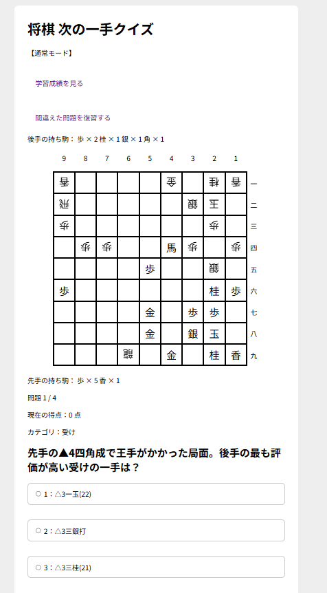
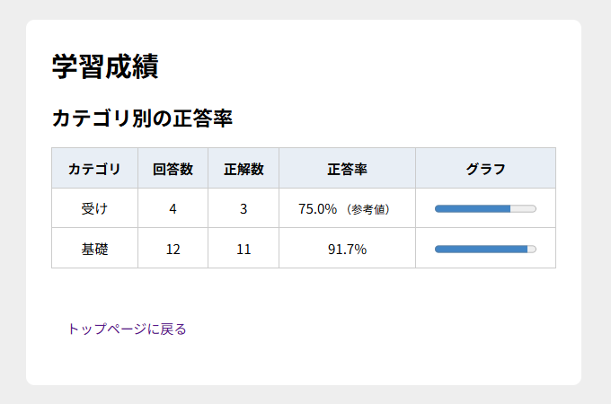

# 将棋 次の一手クイズ

PythonのFlaskを使用して開発した、将棋の「次の一手」をクイズ形式で学習できるWebアプリケーションです。

実戦棋譜を活用した問題演習に加え、解答履歴の保存やカテゴリ別の成績分析、間違えた問題の復習機能を実装しています。

## 画面イメージ

### クイズ画面



### 学習成績画面



## 開発目的

趣味である将棋と、学習中のプログラミングを組み合わせ、実践的なWebアプリケーション開発を経験することを目的として制作しました。

将棋ウォーズで実際に対局した棋譜を使い、「あの局面ではどの手を指すべきだったのか」をクイズ形式で振り返ることで、棋力向上につなげることを目指しています。

また、将棋AIの解析結果を見るだけでなく、問題を自分で解き、間違えた問題を復習することで、正しい指し手の理解と定着を支援したいと考えています。

## 主な機能

### 1. 次の一手クイズ

- 複数問題のランダム出題
- 9×9の将棋盤表示
- 先手・後手の駒および持ち駒の表示
- 3択形式での回答
- 回答時の入力値チェック
- 正誤判定と解説表示
- 正解手を反映した盤面・持ち駒の表示
- 正解手のマスのハイライト
- 得点・正答率・回答結果の表示
- クイズのリセット・再挑戦

### 2. 実戦棋譜の活用

- KIF形式の棋譜読み込み
- 指定した手数までの局面再現
- 実戦の駒配置や持ち駒を用いた問題の作成

### 3. 学習履歴の保存

SQLiteを使用し、以下の情報をデータベースに保存します。

- 問題ID
- 問題のカテゴリ
- 選択した回答
- 正誤判定
- 回答日時

アプリを終了しても、過去の解答履歴を保持できます。

### 4. カテゴリ別の成績分析

- カテゴリごとの回答数・正解数・正答率の集計
- 正答率の棒グラフ表示
- 回答数が少ない場合の「参考値」表示

学習状況を可視化し、苦手分野の把握に役立てます。

### 5. 復習モード

- 過去の解答履歴から復習対象を抽出
- 各問題の最新の回答が不正解の場合、復習対象に設定
- 復習対象の問題だけをランダム出題
- 復習で正解すると、次回の復習対象から除外
- 復習対象がない場合の専用画面表示

通常モードと復習モードで、問題表示・正誤判定・結果画面を共通利用しています。

## 使用技術

| 分類 | 使用技術 |
| --- | --- |
| バックエンド | Python / Flask |
| フロントエンド | HTML / CSS / Jinja2 |
| データベース | SQLite |
| 将棋の棋譜処理 | python-shogi |
| バージョン管理 | Git / GitHub |
| 開発環境 | Eclipse / Windows |

## 実行方法

Pythonがインストールされた環境で、以下の手順を実行します。

### 1. 必要なライブラリのインストール

```bash
pip install -r requirements.txt
```

### 2. アプリの起動

```bash
python app.py
```

### 3. ブラウザでアクセス

以下のURLを開きます。

http://127.0.0.1:5000/

初回起動時には、SQLiteのデータベースと必要なテーブルが自動作成されます。

※ 現在はローカル環境で動作確認しており、一般公開はしていません。

## 工夫した点

### 学習履歴に基づいた復習機能

単に問題を出題するだけでなく、SQLiteに蓄積した解答履歴を利用して、間違えた問題を復習できる仕組みを実装しました。

各問題の最新の解答結果をSQLで取得し、正解できた問題を復習対象から外すことで、継続的な学習を支援します。

### 既存処理の再利用

通常モードと復習モードで共通のクイズ処理を使用できるように、セッションで出題順とモードを管理しています。

出題対象を切り替えながら、問題表示や正誤判定などの処理を再利用しています。

### 入力チェックとデータ管理

不正な回答値や問題番号への対策、同一問題への重複回答防止などを実装しました。

また、データベースの自動初期化や、秘密鍵をソースコードに直接記述しない設定にも取り組みました。

## AIの利用について

開発学習の補助としてChatGPTを利用しています。

アプリの目的や追加したい機能を検討し、ChatGPTからコードの提案や仕組みの説明を受けながら、自分で実装・修正・動作確認を行っています。

特に、Flaskのルーティング、セッション管理、SQLiteによるデータ管理、SQLでの履歴集計などについて、実装と動作確認を通して理解を深めています。

また、実戦問題の作成では、将棋ウォーズの対局棋譜から問題にする局面を選び、棋神アナリティクスを使用して候補手や評価値を比較・検討しています。

将棋AIの解析結果は問題作成時の参考として利用しており、現時点ではWebアプリ内で将棋AIによるリアルタイム解析は行っていません。

## 今後の改善予定

- 実戦棋譜を活用した問題の追加
- 攻め・受けなどのカテゴリの充実
- 直近の成績推移の可視化
- 間違えた回数などを考慮した復習優先度の改善
- Web画面のデザイン改善
- 問題データの管理方法の改善
- Webアプリの公開
- 将棋AIとの連携・評価値表示の検討
